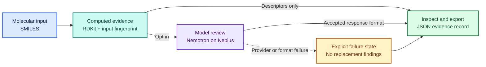

<div align="center">

<h1>🧬 ResistAI</h1>
<h3>Evidence before conclusions.</h3>

<p>A research workbench for molecular calculations, optional AI review,<br/>and an inspectable record of what is known and what is missing.</p>

<p>
  <a href="docs/submission/RELEASE_STATUS.md"></a>
  <a href="#workflow"></a>
  <a href="docs/submission/RELEASE_STATUS.md"></a>
</p>

<p>
  
  
  
  
  
  
  
</p>

<p>
  <a href="#quickstart"><strong>Quickstart</strong></a> ·
  <a href="#workflow">Workflow</a> ·
  <a href="#architecture">Architecture</a> ·
  <a href="#verification">Verification</a> ·
  <a href="#submission-kit">Submission kit</a>
</p>

</div>

> [!IMPORTANT]
> **Research software, not a clinically validated system.** Calculated descriptors and model commentary do not establish measured binding affinity, antimicrobial efficacy, patient safety, or regulatory eligibility. Live model usage, hosted judge access, and completed submission remain separate release gates.

## Overview

ResistAI grew out of an antimicrobial-resistance research prototype. Its focused evidence-review workflow asks three questions: **What was calculated? What did the model say? What evidence is still missing?**

<table>
  <tr>
    <td width="33%" valign="top">
      <h3>🟢 Calculate</h3>
      <p>Compute molecular descriptors with RDKit. Record the canonical structure, software version, and input fingerprint.</p>
      <strong>Actual calculations, not invented scores.</strong>
    </td>
    <td width="33%" valign="top">
      <h3>🟣 Review</h3>
      <p>Explicitly request NVIDIA Nemotron commentary through Nebius Token Factory. Keep generated prose separate from the evidence.</p>
      <strong>Model output remains unreviewed.</strong>
    </td>
    <td width="33%" valign="top">
      <h3>🔵 Inspect</h3>
      <p>Inspect and download the JSON record. Check response metadata, input/output fingerprints, and visible failure states.</p>
      <strong>No silent simulated success.</strong>
    </td>
  </tr>
</table>

The dedicated judge application uses **FastAPI with a small HTML/JavaScript interface**. It exposes the focused workflow, not the legacy biological pipeline. Model review is off by default and requires explicit opt-in.

## Workflow



**Reading the diagram:** blue is the supplied input; teal is computed evidence; violet is optional commentary; green is the inspectable record; amber is an explicit failure. Authentication protects the application, and a persistent attempt limit gates model requests. A rejected request does not become a fabricated result.

<details>
<summary><strong>🔎 What is inside the evidence record?</strong></summary>

The record separates three kinds of information:

| Layer | Recorded information | What it does not prove |
| --- | --- | --- |
| **Computed evidence** | Canonical SMILES, RDKit version, descriptors, input fingerprint | Drug identity, biological activity, or safety |
| **Model commentary** | Structured review and its allowed evidence identifier, when accepted | Scientific accuracy or independent human review |
| **Provider receipt** | Requested and returned model IDs, endpoint, response ID when available, latency, reported token usage, and input/output hashes | Independent attestation or experimental validation |

Format checks do not turn prose into scientific evidence. Failed or rejected reviews are recorded explicitly; no successful model receipt is invented.

</details>

## Quickstart

**Recommended: run the dedicated judge application.** Use Python 3.11 and Bash for the commands below. Access to the private repository is currently required.

```bash
git clone --branch fix/nebius-evidence-integrity-20261030 \
  https://github.com/k2jac9/resist-ai.git
cd resist-ai

python3.11 -m venv .venv
. .venv/bin/activate
python -m pip install -r requirements-submission.txt

mkdir -p data
export RESISTAI_QUOTA_DB="$(pwd)/data/attempts.sqlite3"
export RESISTAI_UI_USER=judge

# Enter secrets without putting their values in shell history.
read -rs -p "Judge password (at least 16 characters): " RESISTAI_UI_PASSWORD
printf '\n'
export RESISTAI_UI_PASSWORD
read -rs -p "Nebius API key: " NEBIUS_API_KEY
printf '\n'
export NEBIUS_API_KEY

export NEBIUS_BASE_URL=https://api.tokenfactory.us-central1.nebius.com/v1
export NEBIUS_MODEL=nvidia/nemotron-3-super-120b-a12b

python -m src.submission_app
```

Open **<http://127.0.0.1:7860>**, authenticate, and leave model review off for the first calculation. The default `CCO` is a software test input, **not an AMR treatment candidate**.

> [!NOTE]
> The dedicated application reads **process environment variables**, not an automatically loaded `.env` file. It refuses startup without judge authentication, a provider key, and an absolute writable quota-database path. Having a key configured does not establish a successful provider call.

### Provider configuration

| Setting | Purpose |
| --- | --- |
| `NEBIUS_API_KEY` | Server-side provider credential; never commit or expose it |
| `NEBIUS_BASE_URL` | Configured default: `https://api.tokenfactory.us-central1.nebius.com/v1` |
| `NEBIUS_MODEL` | Configured default: `nvidia/nemotron-3-super-120b-a12b` |
| `RESISTAI_UI_USER` / `RESISTAI_UI_PASSWORD` | Separate judge credentials, not the provider key |
| `RESISTAI_QUOTA_DB` | Absolute path to the persistent SQLite attempt database |

Verify actual account/model access and the **returned model identity** during qualification. The integration's reference is the [Nebius Nemotron cookbook](https://github.com/nebius/token-factory-cookbook/blob/main/models/nemotron/nemotron3-super-120B.md); a configured model name alone is not proof of usage or eligibility.

<details>
<summary><strong>🐳 Run the dedicated Docker profile</strong></summary>

After configuring the environment variables above:

```bash
docker build -f Dockerfile.submission -t resistai-evidence .
docker volume create resistai-evidence-data

docker run --rm -p 127.0.0.1:7860:7860 \
  --mount source=resistai-evidence-data,target=/data \
  -e NEBIUS_API_KEY -e NEBIUS_BASE_URL -e NEBIUS_MODEL \
  -e RESISTAI_UI_USER -e RESISTAI_UI_PASSWORD \
  resistai-evidence
```

For hosted deployment, put the service behind managed HTTPS. Use one replica and a persistent `/data` volume writable by UID/GID `10001`. Do not replace this with ephemeral storage or independent per-replica databases: that resets or multiplies the attempt allowance. See the [complete hosting and judge-acceptance guide](docs/submission/README.md).

</details>

<details>
<summary><strong>🧪 Use the broader local research interface</strong></summary>

The older Gradio interface is retained separately. To explore descriptor calculations without a provider key:

```bash
python -m pip install -r requirements-dev.txt
cp .env.example .env
python -m src.app
```

Run this from the repository root. The local Gradio interface defaults to loopback, reads the root `.env`, and reports provider-backed operations unavailable without credentials. Its public-bind setting is `RESISTAI_HOST`; the dedicated submission profile instead uses `RESISTAI_UI_HOST`.

Co-folding views show Boltz-2 structural-confidence metrics, not measured affinity. Legacy orchestration and simulations remain explicitly unverified. `NVIDIA_API_KEY` is separate from the Nebius key and is used by the retained NVIDIA-hosted biology clients; those clients are not part of the dedicated judge workflow.

</details>

## Security and operating limits

| Control | Dedicated submission profile |
| --- | --- |
| 🔐 **Authentication** | Interface and review route require HTTP Basic authentication; use HTTPS for hosted access |
| 🧱 **Narrow application surface** | No legacy pipeline, API documentation, or server file-export routes |
| ⏱️ **Persistent admission** | Default: 4 model attempts per rolling minute, 40 per rolling 24 hours, 200 over the database lifetime |
| 🧾 **Conservative accounting** | Failed model attempts count; descriptor-only requests do not consume model attempts |
| 🛡️ **Bounded transport** | Input/output limits, no redirects or retries, and per-operation HTTP timeouts |
| 📦 **Browser-side export** | Download the displayed JSON record without a server-side export file |

The global attempt settings are `RESISTAI_MODEL_PER_MINUTE`, `RESISTAI_MODEL_PER_DAY`, and `RESISTAI_MODEL_LIFETIME`. Preserve the database across restarts and releases.

> [!WARNING]
> Request limits are **not an account-wide dollar cap**, per-user isolation, or a total wall-clock deadline. Configure provider spending controls separately. Keep API keys and judge passwords out of source control, public documentation, videos, and submission fields intended for public display.

## Architecture

| Component | Responsibility |
| --- | --- |
| [`src/submission_app.py`](src/submission_app.py) + [`src/submission.html`](src/submission.html) | Authenticated judge application and browser UI |
| [`src/request_limits.py`](src/request_limits.py) | Atomic, persistent model-attempt admission |
| [`src/research_integrity.py`](src/research_integrity.py) | Molecular descriptors and evidence classification |
| [`src/research_review.py`](src/research_review.py) | Optional, format-checked model commentary |
| [`src/models/nebius_transport.py`](src/models/nebius_transport.py) | Bounded provider exchange and response receipts |
| [`src/models/llm_client.py`](src/models/llm_client.py) | Research prompts and the historical `NebisLLM` interface |
| [`Dockerfile.submission`](Dockerfile.submission) | Dedicated submission runtime |
| [`tests/`](tests/) | Application, transport, evidence, and admission checks |

<details>
<summary><strong>🗂️ Retained interfaces and scientific boundaries</strong></summary>

The repository also contains the Gradio interface, SDK, CLI, broader FastAPI routes, generation modules, and legacy orchestration. They have **not** all been migrated to the focused evidence contract.

The legacy orchestrator retains unverified hardcoded target/compound records, heuristic fallbacks, and metadata that must not be treated as established model provenance. Regulatory forecasts, synthetic explainability, cost comparisons, and presentation scripts are not qualified scientific capabilities. Their presence in the repository does not mean they are part of the dedicated submission application.

See the [readiness audit](docs/NEBIUS_READINESS_2026-10-30.md), [evidence-integrity design](docs/superpowers/specs/2026-10-30-evidence-integrity-design.md), and [implementation plan](docs/superpowers/plans/2026-10-30-evidence-integrity.md).

</details>

## Verification

<a href="https://github.com/k2jac9/resist-ai/actions/runs/41019726922"></a>

**Verified implementation:** [`fbb11f9`](https://github.com/k2jac9/resist-ai/commit/fbb11f9303755be56eba30711e357342c774b9a8), recorded October 30, 2026. This is a pinned verification record, not a claim about every future commit.

| Check | Recorded outcome |
| --- | --- |
| 🟢 Full repository tests | **365 passed** under CPython 3.11.17 with the repository requirements |
| 🟢 Syntax and lint | Tracked Python compilation and Ruff passed |
| 🟢 Container acceptance | Submission image built; authentication and real-descriptor smoke checks passed |
| 🟠 Live provider and hosted acceptance | **Pending**; controlled test responses are not live model usage |

Read the [CI run](https://github.com/k2jac9/resist-ai/actions/runs/41019726922) and [exact-commit release record](docs/submission/RELEASE_STATUS.md).

```bash
python -m pip install -r requirements-dev.txt
ruff check src/ tests/ scripts/
python -m pytest -q
```

<details>
<summary><strong>🔌 Probe a real Nebius response</strong></summary>

With the server-side provider environment configured:

```bash
python scripts/smoke_nebius.py \
  --smiles CCO \
  --output /tmp/resistai-nebius-smoke.json
```

Exit `0` means a response passed the review-format checks. Exit `2` means the review did not complete successfully. Inspect the returned model identity, receipt, and commentary. This direct local probe is not the authenticated submission route and does not replace hosted quota or judge-access acceptance.

</details>

## Submission kit

| Open this | What you will find |
| --- | --- |
| 🚀 [Setup and judge instructions](docs/submission/README.md) | Environment, hosting contract, and acceptance procedure |
| 📝 [Devpost draft](docs/submission/DEVPOST.md) | Prepared project story and submission copy |
| 🎬 [Video script](docs/submission/VIDEO_SCRIPT.md) | A 2:40 plan for filming actual application behavior |
| 💬 [Feedback worksheet](docs/submission/FEEDBACK.md) | Implementation notes and space for measured live observations |
| 🚦 [Release status](docs/submission/RELEASE_STATUS.md) | Verified work, unresolved access requirements, and release gates |
| 🔎 [Draft PR #15](https://github.com/k2jac9/resist-ai/pull/15) | The working branch and review history |

**Release snapshot, October 30, 2026:** code, tests, and container checks are prepared and verified as identified above. Live inference, hosted judge access, public-source licensing, a qualifying public video, team confirmation, and final submission are not yet established by this work record. There is no verified live-demo or submitted-entry link to present.

## Provenance and ownership

ResistAI originated with **Team BioHack** at the Evolved 25 health/life-sciences hackathon. This branch reuses that foundation and separates inherited functionality from the October 30 evidence-integrity and submission-profile changes. Earlier performance and regulatory claims are not repeated as verified findings.

[Selectra](https://github.com/k2jac9/selectra) is a separate private sibling project; this work does not change its scope or licensing.

**Copyright (c) 2026 Team BioHack. All rights reserved. License terms to be determined.** Public distribution and an open-source license require the appropriate ownership permissions.

---

<p align="center"><strong>🧬 Calculate precisely. Label uncertainty. Keep the record.</strong></p>
