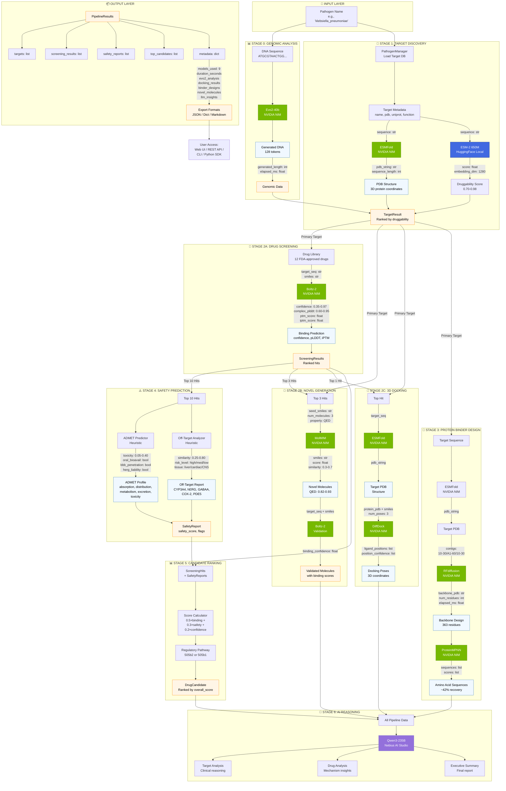

# ResistAI Pipeline Data Flow Diagram

## Complete 9-Model Data Flow Architecture



## Data Schema Flow

### Stage 0: Genomic Analysis
```python
Input:  DNA sequence (str)
Output: {
    "success": bool,
    "generated_length": int,      # nucleotides generated
    "elapsed_ms": float,
    "model": "Evo2-40b (NVIDIA NIM)"
}
```

### Stage 1: Target Discovery
```python
Input:  Pathogen name (str)
Output: TargetResult[] = [
    {
        "name": str,                    # e.g., "NDM-1"
        "pdb_code": str,                # e.g., "3SPU"
        "uniprot_id": str,              # e.g., "C7C422"
        "function": str,                # includes ESMFold timing
        "druggability_score": float,    # 0.70-0.98
        "pathogen": str,
        "resistance_mechanism": str
    }
]
# Sorted by druggability_score DESC
```

### Stage 2A: Drug Screening
```python
Input:  TargetResult, Drug Library
Process: For each drug:
    Boltz-2.predict_binding(target_seq, smiles)
Output: ScreeningResults = {
    "target_name": str,
    "compounds_screened": int,
    "hits": ScreeningHit[] = [
        {
            "rank": int,
            "drug_name": str,
            "smiles": str,
            "target_name": str,
            "binding_affinity": float,  # 0.35-0.97 (Boltz-2 confidence)
            "confidence": float,        # 0.60-0.95 (complex pLDDT)
            "mechanism_of_action": str,
            "clinical_phase": str
        }
    ],
    "threshold_used": 0.5,
    "model_used": "Boltz-2 (NVIDIA NIM)"
}
# Hits sorted by binding_affinity DESC
```

### Stage 2B: Novel Molecule Generation
```python
Input:  Top 3 ScreeningHits
Process:
    1. For each hit:
        MolMIM.generate_molecules(seed_smiles, num=3, property="QED")
    2. For each generated molecule:
        Boltz-2.predict_binding(target_seq, novel_smiles)
Output: Novel Molecules[] = [
    {
        "smiles": str,                  # novel SMILES
        "qed_score": float,             # 0.82-0.93 drug-likeness
        "seed_drug": str,               # parent hit name
        "binding_confidence": float,    # Boltz-2 validation
        "target": str,
        "source": "MolMIM (NVIDIA NIM)"
    }
]
```

### Stage 2C: 3D Molecular Docking
```python
Input:  Top ScreeningHit, Target Sequence
Process:
    1. ESMFold.fold_protein(target_seq) → pdb_string
    2. DiffDock.dock_molecule(pdb_string, smiles, num_poses=3)
Output: Docking Results[] = [
    {
        "drug": str,
        "target": str,
        "poses": int,                   # number of poses
        "confidence": list[float],      # per-pose confidence
        "source": "DiffDock (NVIDIA NIM)"
    }
]
```

### Stage 3: Protein Binder Design
```python
Input:  Target Sequence
Process:
    1. ESMFold.fold_protein(target_seq) → target_pdb
    2. RFdiffusion.design_binder(target_pdb, contigs) → backbone_pdb
    3. ProteinMPNN.design_sequence(backbone_pdb) → sequences[]
Output: Binder Designs[] = [
    {
        "target": str,
        "backbone_residues": int,       # typically 363
        "sequences_designed": int,
        "rfdiffusion_ms": float,
        "source": "RFdiffusion + ProteinMPNN (NVIDIA NIM)"
    }
]
```

### Stage 4: Safety Prediction
```python
Input:  Top 10 ScreeningHits
Process: For each hit:
    stage_safety_score(drug_name)
Output: SafetyReport[] = [
    {
        "drug_name": str,
        "smiles": str,
        "safety_score": float,          # 1.0 - toxicity
        "admet": {
            "absorption": float,         # 0.5-0.95
            "distribution": float,       # 0.4-0.9
            "metabolism": float,         # 0.3-0.85
            "excretion": float,          # 0.4-0.9
            "toxicity_score": float,     # 0.05-0.40
            "oral_bioavailability": bool,
            "bbb_penetration": bool,
            "herg_liability": bool
        },
        "off_target_report": {
            "off_targets": [
                {
                    "protein_name": str,  # CYP3A4, hERG, GABAA, etc.
                    "similarity": float,  # 0.25-0.80
                    "risk_level": str,    # high/medium/low
                    "tissue": str         # liver, cardiac, CNS, etc.
                }
            ],
            "overall_risk": str           # high/low
        },
        "flags": list[str],              # hERG_liability, etc.
        "recommendation": str            # proceed/caution
    }
]
```

### Stage 5: Candidate Ranking
```python
Input:  ScreeningHits[], SafetyReports[]
Process:
    overall_score = (
        0.5 × binding_affinity +        # Boltz-2 confidence
        0.3 × safety_score +            # 1.0 - toxicity
        0.2 × confidence                # complex pLDDT
    )
    regulatory_pathway = (
        "505(b)(2)" if phase in ["Approved", "Phase 3"]
        else "505(b)(1)"
    )
Output: DrugCandidate[] = [
    {
        "rank": int,
        "drug_name": str,
        "smiles": str,
        "target_name": str,
        "binding_affinity": float,
        "safety_score": float,
        "overall_score": float,          # composite score
        "regulatory_pathway": str,       # 505(b)(2) or 505(b)(1)
        "confidence": float
    }
]
# Sorted by overall_score DESC
```

### Stage 6: AI Reasoning
```python
Input:  All pipeline data
Process:
    1. Qwen3-235B.analyze_target(target_name, pathogen, pdb, function)
    2. Qwen3-235B.analyze_drug_candidate(drug_name, smiles, target, affinity)
    3. Qwen3-235B.generate_executive_report(pathogen, targets, candidates)
Output: LLM Insights = {
    "target_analysis": str,           # clinical reasoning about target
    "top_drug_analysis": str,         # mechanism and potential
    "executive_summary": str          # comprehensive report
}
```

### Final Output: PipelineResults
```python
PipelineResults = {
    "pathogen": str,
    "targets": TargetResult[],
    "screening_results": ScreeningResults[],
    "safety_reports": SafetyReport[],
    "top_candidates": DrugCandidate[],  # ranked
    "metadata": {
        "timestamp": str,                # ISO 8601
        "duration_seconds": float,
        "models_used": [
            "Evo2-40b (NVIDIA NIM)",
            "ESM-2 650M (HuggingFace, local)",
            "ESMFold (NVIDIA NIM)",
            "Boltz-2 (NVIDIA NIM)",
            "MolMIM (NVIDIA NIM)",
            "DiffDock (NVIDIA NIM)",
            "RFdiffusion (NVIDIA NIM)",
            "ProteinMPNN (NVIDIA NIM)",
            "Qwen3-235B (Nebius AI Studio)"
        ],
        "compounds_screened": int,
        "demo_mode": bool,
        "evo2_analysis": dict,
        "docking_results": list[dict],
        "binder_designs": list[dict],
        "llm_insights": dict,
        "novel_molecules": list[dict]
    }
}

# Export methods
results.to_dict()     → Python dict
results.to_json()     → JSON string
results.to_report()   → Markdown report
```

## Model Endpoints

| # | Model | Provider | Endpoint | Function |
|---|-------|----------|----------|----------|
| 1 | **Evo2-40b** | NVIDIA NIM | `nvidia/evo2-40b` | Genomic sequence generation |
| 2 | **ESM-2 650M** | HuggingFace | Local | Druggability scoring |
| 3 | **ESMFold** | NVIDIA NIM | `nvidia/esmfold` | Protein structure prediction |
| 4 | **Boltz-2** | NVIDIA NIM | `nvidia/boltz-2` | Binding affinity prediction |
| 5 | **MolMIM** | NVIDIA NIM | `nvidia/molmim` | Novel molecule generation |
| 6 | **DiffDock** | NVIDIA NIM | `nvidia/diffdock` | 3D molecular docking |
| 7 | **RFdiffusion** | NVIDIA NIM | `nvidia/rfdiffusion` | Protein backbone design |
| 8 | **ProteinMPNN** | NVIDIA NIM | `nvidia/proteinmpnn` | Amino acid sequence design |
| 9 | **Qwen3-235B** | Nebius AI | `Qwen/Qwen3-235B-A22B` | Clinical reasoning |

## Performance Metrics

| Stage | Model | Typical Latency | Output Size |
|-------|-------|-----------------|-------------|
| 0 | Evo2-40b | ~2-5s | 128+ nucleotides |
| 1B | ESMFold | ~1-3s | PDB file (~50-200KB) |
| 1C | ESM-2 | ~100-500ms | Single float score |
| 2A | Boltz-2 | ~3-10s per drug | CIF structure + scores |
| 2B | MolMIM | ~5-15s per hit | 3-10 novel molecules |
| 2C | DiffDock | ~5-20s | 3 poses with coordinates |
| 3 | RFdiffusion | ~10-30s | Backbone PDB |
| 3 | ProteinMPNN | ~2-5s | 1-5 sequences |
| 6 | Qwen3-235B | ~5-15s | 500-2000 token response |

**Total Pipeline Duration:** 30 seconds - 5 minutes (depending on API availability and payload size)

## Key Implementation Notes

1. **Lazy Loading:** Models are loaded on-demand via `_get_llm()` and `_get_nim()` to minimize resource usage
2. **Graceful Fallbacks:** Each stage has heuristic fallbacks when APIs are unavailable
3. **Progress Callbacks:** Pipeline emits progress updates at 15 checkpoints (0% → 100%)
4. **Error Handling:** Failures in optional stages (Evo2, docking, binders) don't halt the pipeline
5. **Demo Mode:** Can run entire pipeline without API calls for testing/presentation
6. **Parallel Processing:** Stages 2A and 4 process multiple items independently (could be parallelized)
7. **Result Caching:** ESMFold results are reused across docking and binder design stages

## Code References

- **Orchestrator:** `src/pipeline/orchestrator.py:315` (PipelineOrchestrator.run_full_pipeline)
- **Stage Functions:** `src/pipeline/stages.py:16-228`
- **Data Schemas:** `src/models/schemas.py:1-430`
- **NIM Client:** `src/models/nim_client.py`
- **LLM Client:** `src/models/llm_client.py`
- **Pathogen Data:** `src/data/pathogens.py:15` (PathogenManager)

---

*Generated for ResistAI Pipeline v1.0 | Evolved 25 Hackathon 2026*
